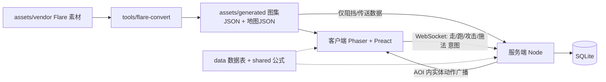

# 2D 完美世界（PWI 1.3.6 玩法 × 传奇世界视角）—— 构建计划

> **目标**：在本仓库中构建一个 **传奇世界风格（2.5D 斜视角、格子移动）**、浏览器可玩、服务端说了算的 MMORPG。玩法和数值仿照《完美世界国际版》1.3.6：**人族、羽族、妖族三族，共六个职业**。
>
> **性质**：个人学习/测试项目，不商用。美术用开源的 **Flare** 素材（CC-BY-SA 3.0）；所有外观都通过"素材替换层"引用，以后可以整体换成别的素材（见第 2 节）。
>
> **当前环境**：Node.js v22 / npm 10 / Python 3.13。M0 脚手架已完成，Flare 素材已拉取到 `assets/vendor/flare-game/`。

---

## 0. 已确认的范围

### 0.1 种族与职业（只做这六个）

| 种族 | 职业         | 性别限制 | 定位                        | Flare 素材方案                                                                                          |
| ---- | ------------ | -------- | --------------------------- | ------------------------------------------------------------------------------------------------------- |
| 人族 | 武侠         | 男/女    | 近战物理输出，多种武器      | 链甲/板甲 + longsword / greatsword / battle_axe / maul；动作用 swing                                    |
| 人族 | 法师         | 男/女    | 远程五行法术（火/水/土）    | mage_vest/hood/skirt + greatstaff；动作用 cast；特效用 fireball / icicle / quake                        |
| 羽族 | 羽芒（弓手） | 男/女    | 远程物理，射程长            | 皮甲 + longbow / greatbow；动作用 **shoot**；特效用 arrows                                              |
| 羽族 | 羽灵（牧师） | 男/女    | 治疗、增益、木系法术        | mage_*_alt 系列（换色区分）+ staff；特效用 heal / shield / sparkle                                      |
| 妖族 | 妖兽         | 仅男     | 肉盾近战，可变身成兽形      | 板甲 + maul/battle_axe；兽形借用怪物精灵（如 minotaur）                                                 |
| 妖族 | 妖精         | 仅女     | 召唤并驯养宠物，毒/木系法术 | female 布甲 + staff；宠物借用怪物精灵（antlion / fire_ant / wyvern 等）；特效用 dark_mist / spark_green |

> Flare 角色是 8 方向，有 stance / run / swing / block / hit / die / cast / shoot 八种动作。没有单独的"走路"动画，走路就用 run 放慢播放。
> 种族区分：妖族用 `female_dark` 肤色以及更粗犷的装备；羽族翅膀先不做，只在飞行时用"飞行器"表现，以后可以补画翅膀图层。

### 0.2 玩法范围（1.3.6 经典）

- 等级 1–105，修真 1–9 阶，之后分仙/魔。
- 核心系统：技能/元神、装备精炼、镶嵌、宠物、组队、副本（FB）、飞行器、帮派、领土战、摆摊。
- 元婴/小精灵、商城等放到最后。

### 0.3 视角与操作：参考传奇世界

| 项目     | 方案                                                                                                                                                           |
| -------- | -------------------------------------------------------------------------------------------------------------------------------------------------------------- |
| 投影     | 2.5D **等距菱形**（2:1），跟 Flare 素材保持一致；一个逻辑格 = 一块 192×96 的瓦片。投影公式封装在 `shared/grid.ts` 里，以后要换成传奇式的矩形斜视角，只改这一处 |
| 移动     | **格子步进**：走 1 格、跑 2 格，8 个方向；每一步都有固定耗时，服务端按步校验                                                                                   |
| 操作     | 鼠标左键走/跑（按住 Shift 或右键跑）、点怪自动寻路到射程内再攻击（PW 风格的锁定目标 + 传奇风格的点地移动）、F1–F8 技能快捷键、Tab 切换目标                     |
| 画面     | 以玩家为中心的固定镜头；底部是传奇风格的主面板（血蓝球、快捷栏、聊天框）                                                                                       |
| 绘制顺序 | ① 地面层（background）→ ② **按 x+y 逐行**绘制物件层（建筑/树木）和角色/怪物，实现遮挡 → ③ 技能特效 / 飘字 → ④ UI                                               |
| 角色图层 | 纸娃娃分层：头 + 胸甲 + 手 + 腿 + 脚 + 主手 + 副手（跟 Flare 一致），8 方向 × 动作，**每帧都带锚点偏移**（Flare 动画定义 `frame=序号,方向,x,y,w,h,ox,oy`）     |
| 飞行     | Flare 没有飞行，自己扩展：飞行时角色往上抬高绘制、地面留阴影、无视地面阻挡、可穿越"可飞区域"                                                                   |

---

## 1. 技术选型

| 层         | 选型                                                                                        | 理由                                                     |
| ---------- | ------------------------------------------------------------------------------------------- | -------------------------------------------------------- |
| 语言       | **TypeScript**（全栈）                                                                      | 前后端共用协议、公式、数据表                             |
| 仓库管理   | **npm workspaces** monorepo                                                                 | 本机已有 npm                                             |
| 客户端渲染 | **Phaser 3** + Vite（WebGL）                                                                | 精灵动画、相机、纹理图集都现成；绘制深度按"行号"手动控制 |
| 客户端 UI  | **Preact** 覆盖层 + CSS（传奇风格皮肤）                                                     | 背包/技能/任务等面板用 DOM 写更省事                      |
| 服务端     | **Node.js + ws**，自己写的服务端（逻辑 tick 20Hz，移动按步计时）                            | 格子 MMO 用自研更简单可控                                |
| 序列化     | 先用 JSON，后期换 MessagePack                                                               | 先方便调试                                               |
| 数据库     | **SQLite**（better-sqlite3）+ Drizzle ORM                                                   | 个人项目足够；以后可以无痛切到 PostgreSQL                |
| 数据表     | YAML + **zod** 校验，构建时编译成 JSON                                                      | 改数值不用动代码                                         |
| 素材管线   | **Node 脚本**：把 Flare 的动画定义 txt 和地图 txt 转成 Phaser 能用的 atlas JSON 和地图 JSON | 只用一种主语言                                           |
| 测试       | Vitest（公式/逻辑）、Playwright（E2E）、无头机器人（压测）                                  | 战斗公式必须有回归测试                                   |

---

## 2. 素材策略（重点）

### 2.1 来源与存放

```
assets/vendor/flare-game/   ← Flare 开源素材，用 tools/fetch-assets.sh 拉取（.gitignore，约 780MB）
assets/generated/           ← 转换产物：atlas JSON、地图 JSON（.gitignore，可以随时重新生成）
assets/CREDITS.md           ← 授权与署名登记（进 Git）
```

- Flare 美术采用 **CC-BY-SA 3.0**：必须署名；改编后的素材也要用同样的协议发布。游戏里要有一个"素材致谢"页面。
- 可用内容：`images/avatar/{male,female,female_dark}` 分层装备（约 50 件/性别），`images/enemies` 怪物（goblin、skeleton、antlion、minotaur、wyvern 等），`images/npcs`，`images/powers` 技能特效，`images/tilesets` 地形（草原/雪原/洞穴/地牢），`images/icons` 物品图标，`empyrean_campaign/maps` 现成的地图。

### 2.2 素材替换层（以后换素材靠它）

游戏代码 **不直接引用 Flare 的文件路径**，只认"逻辑外观 ID"：

```yaml
# packages/data/appearance/manifest.yaml
armor.cloth_shirt: { source: flare, layer: chest, file: cloth_shirt } # 按性别自动选 male/female 目录
weapon.longsword: { source: flare, layer: main, file: longsword }
monster.goblin: { source: flare, file: enemies/goblin }
effect.fireball: { source: flare, file: powers/fireball }
```

以后换素材只要改 manifest 和对应的资源包，游戏逻辑一行都不用动。

### 2.3 Flare 格式（已确认）

- **动画定义** `animations/**/*.txt`：用 `[stance] [run] [swing] [block] [hit] [die] [cast] [shoot]` 分段，每段有 `frames / duration / type(looped|play_once|back_forth)`，每帧一行 `frame=序号,方向,x,y,w,h,锚点x,锚点y`，图片在 `image=` 指定的整张 PNG 图集里。
- **地图** `maps/*.txt`：等距地图，`[header]`（宽高、瓦片 192×96）、多个 `[layer]`（background / object / collision 的 CSV）、`[event]`（传送点等）、`[enemy]` 刷怪。
- **瓦片集** `tilesetdefs/*.txt`：`tile=编号,x,y,w,h,偏移x,偏移y`。
- 转换器只要把这些 txt 转成 Phaser 的 atlas JSON（每帧的 frame 区域 + 锚点 pivot）和自定义地图 JSON 就行，不需要逆向二进制格式。

---

## 3. 仓库结构

```
2dpw/
├── package.json / tsconfig.base.json / .gitignore / eslint / prettier / vitest
├── docs/
│   ├── PLAN.md
│   └── design/                 # 战斗、技能、经济、修真等设计文档
├── assets/
│   ├── CREDITS.md
│   ├── vendor/flare-game/      # (ignored) Flare 原始素材
│   └── generated/              # (ignored) 转换产物
├── tools/
│   ├── fetch-assets.sh         # ✅ 拉取 Flare 素材
│   ├── flare-convert/          # 动画 txt → atlas JSON；地图 txt → 地图 JSON
│   └── viewer/                 # 浏览器里预览 纸娃娃 8 方向动画 / 怪物 / 地图
├── packages/
│   ├── shared/                 # ✅ 协议、常量、网格/方向（等距投影）、种族职业定义；后续加 A*、公式、zod schema
│   ├── data/                   # YAML 数据表：职业/技能/物品/怪物/掉落/NPC/任务/地图/外观
│   ├── server/                 # ✅ ws 网关 + tick 循环；后续加 区域/AOI、实体、各系统、存档
│   └── client/                 # ✅ Phaser 启动场景 + 连接；后续加 地图渲染器、纸娃娃角色、UI
└── .github/workflows/ci.yml
```

---

## 4. 核心架构



### 4.1 传奇式同步模型（比连续移动简单很多）

- 客户端发 `Walk(dir)` / `Run(dir)` / `Attack(targetId)` / `Cast(skillId, target|cell)`。
- 客户端 **先在本地播放动作**；服务端校验（是否阻挡、步间隔是否太短、射程、冷却），通过就广播给 AOI 里的其他人，不通过就发 `Correct(x, y)` 把角色拉回。
- 每个实体在同一时间只占一格（可以配置：是否允许穿人/穿怪）。
- AOI：按格子分块（例如 20×20 格一块），只同步周围 3×3 块。
- 动作节奏：走一步约 600ms，跑一步（2 格）约 600ms，攻速/施法时间由属性决定，全部写在数据表里。

### 4.2 地图

- 先用 Flare `empyrean_campaign/maps` 里现成的地图转换成 JSON（城镇、野外、洞穴、地牢都有），改个名充当 PW 的主城、野外和副本。
- 服务端只加载阻挡、传送点、安全区；刷怪区写在我们自己的 YAML 里（Flare 地图里的 `[enemy]` 段只作参考）。
- 新地图或改地图：用 **Tiled**（Flare 官方地图就是用 Tiled 做的，有现成的瓦片集）。

---

## 5. 游戏系统设计要点（1.3.6 风格）

### 5.1 属性与公式（`packages/shared/src/formulas`）

- 四项基础属性：**体质 / 灵力 / 力量 / 敏捷**；每级 5 个自由点，另外每个职业有固定成长。
- 派生属性：生命、真气、物攻、法攻、物防、**金/木/水/火/土**五行防御、命中、闪避、攻速、吟唱速度、暴击率。
- 物理伤害 = f(物攻, 物防, 攻击等级, 防御等级, 等级差)；法术伤害按技能的五行属性，用目标对应的抗性结算。
- 元气：普攻和受击会积累，满 1/2/3 段可以放元气技能。
- 射程从 PW 的"米"换算成"格"（例如 1 格 ≈ 2 米，统一在常量里配置）。
- 所有公式都写成纯函数，并用 Vitest 覆盖。

### 5.2 技能（每个职业先做 8–12 个核心技能）

- 数据驱动：`施法时间 / 冷却 / 消耗 / 射程(格) / 范围形状(单体、以自身为圆心、以目标为圆心、直线、扇形) / 效果列表 / 特效外观ID`。
- 效果原子：伤害、治疗、Buff/Debuff（眩晕、定身、减速、沉默、睡眠）、击退（按格）、召唤宠物、变身。
- 学习：花金币 + 元神，部分技能需要技能书。

### 5.3 物品与装备

- 部位：武器、头、衣、腿、鞋、护腕、项链、腰带、戒指×2、披风、飞行器、时装。
- 衣服和武器决定纸娃娃外观（物品数据表里的 `appearance` 字段指向外观 ID）。
- 精炼 +1~+12（失败会降级/归零，可用保护道具）、镶嵌（孔位 + 属性石）、采集与制造。

### 5.4 内容（第一期最小集）

- 一座主城（拿 Flare 的城镇地图改造）+ 新手村 + 1–30 级野外 2–3 张 + 1 个副本（找一张洞穴地图做成实例）。
- 任务：主线、日常；类型包括击杀/收集/对话/护送。

### 5.5 社交、成长与经济

- 组队、好友、聊天频道、交易、摆摊。
- 修真任务链（技能等级上限和修真挂钩）、宠物（捕捉/驯养/技能）。
- 帮派 → 领土战（最后做）。
- 金币来源：打怪、任务；金币消耗：修理、精炼、学技能、NPC 商店。

---

## 6. 里程碑与任务分解

> M0–M4 做完就有一个 **可玩原型**。每个阶段都有退出标准。

### M0 — 工程脚手架（约 3–5 天）

- [x] npm workspaces：`shared` / `server` / `client`（`data` 等到 M3 需要的时候再加）
- [x] TypeScript strict、ESLint、Prettier、Vitest
- [x] Vite + Phaser 空场景；Node ws 服务端；`npm run dev` 一键启动两端
- [x] `.gitignore`、`README.md`、`assets/CREDITS.md`、`tools/fetch-assets.sh`，首次提交
- **退出标准**：浏览器页面显示"已连接服务器"。

### M0.5 — Flare 素材管线（约 1 周）

- [x] 拉取 Flare 素材（`tools/fetch-assets.sh`）
- [x] `tools/flare-convert`：动画 txt → JSON（含锚点与多图集支持）
- [x] 地图 txt + tilesetdef → 地图 JSON（地面层、物件层、阻挡、传送点、刷怪）
- [x] 预览器（`ViewerScene`，访问 `?scene=viewer` 或点击启动页按钮）：浏览器预览 纸娃娃 8 方向动画 / 怪物 / NPC / 技能特效 / 整张地图
- [x] 外观 manifest 初版（`DEFAULT_MANIFEST`）：6 职业 × 性别（10 套预设）、12 种怪物、5 种 NPC、10 种技能特效、4 张地图
- **退出标准**：viewer 能正确显示一张 Flare 地图（遮挡正确），角色 8 方向各动作的分层对得上，不抖。

### M1 — 地图渲染与格子移动（约 2 周）

- [ ] 客户端地图渲染器：地面层 + 物件按 x+y 排序，只绘制视口范围（大地图分块）
- [ ] 纸娃娃角色渲染（头/胸/手/腿/脚/主手/副手 叠层，按方向调整图层顺序，锚点对齐）
- [ ] 走/跑步进、8 方向、点地 A* 寻路（shared 里实现，前后端共用）
- [ ] 服务端：加载阻挡、按步校验、拉回、AOI 广播
- [ ] 地图切换：传送点 → 加载新地图
- **退出标准**：两个浏览器窗口在同一张地图里互相能看到对方走跑，遮挡正确，过不去阻挡。

### M2 — 账号、角色与存档（约 1 周）

- [ ] 注册/登录（密码哈希、会话令牌）
- [ ] 创建角色：选种族 → 职业（带性别限制）→ 发型/发色
- [ ] 选角界面（显示角色站立动画）；进入世界；定时存盘 + 下线存盘
- **退出标准**：重启服务端后，角色位置、等级、背包都还在。

### M3 — 战斗核心（约 3 周）

- [ ] 公式库 + 单元测试（6 职业 1/30/60 级样本）
- [ ] 锁定目标、自动接近、普攻（近战相邻格 / 远程按射程）、攻速
- [ ] 技能框架：吟唱条 → 释放 → 冷却；打断；元气
- [ ] Buff/Debuff；怪物 AI（巡逻、仇恨、追击、脱战回归、技能）
- [ ] 刷怪区、重生、死亡/复活点、经验惩罚、升级、加点
- [ ] 表现：受击/死亡动作、飘字、技能特效、魔法飞行物
- **退出标准**：任意职业能在新手区练到 10 级，战斗反馈完整。

### M4 — 物品、背包与 NPC（约 2–3 周）

- [ ] 物品数据表与实例；背包/仓库/装备栏（拖拽）；快捷栏
- [ ] 掉落表、地面物品显示与拾取归属
- [ ] NPC 对话、商店、修理；换装后外观实时变化
- **退出标准**：打怪 → 掉装备 → 穿上（外观和属性都变）→ 回城卖垃圾，形成闭环。🎯 **可玩原型**

### M5 — 任务与六职业完善（约 3–4 周）

- [ ] 任务系统（条件、追踪、奖励、任务链）+ 1–30 级主线
- [ ] 六职业各 8–12 个核心技能，做平衡测试
- [ ] 妖精：宠物召唤/跟随/攻击指令；妖兽：变身（换外观 + 换技能栏）
- [ ] 羽芒：箭矢飞行物；羽灵：治疗和增益
- [ ] 元神（SP）与技能学习 NPC
- **退出标准**：六个职业都能从 1 级成长到 30 级。

### M6 — 社交与组队（约 2 周）

- [ ] 聊天频道（附近/世界/队伍/私聊）
- [ ] 组队（经验共享、掉落分配）、好友、交易窗口（双方确认）
- **退出标准**：两名玩家可以组队打怪、交易、聊天。

### M7 — 副本与飞行（约 3 周）

- [ ] 副本实例管理（按队伍复制地图实例，空了就销毁）
- [ ] 第一个 FB：几波小怪 + 精英 + 多阶段 Boss
- [ ] 飞行：飞行器道具、抬高绘制 + 阴影、无视阻挡、耗飞行值、禁飞区
- **退出标准**：组队通关一个副本；能在野外飞行跨越阻挡区域。

### M8 — 装备养成与生活技能（约 2–3 周）

- [ ] 精炼（概率表、失败规则、保护道具、日志）、镶嵌
- [ ] 采集、制造、摆摊
- **退出标准**："刷材料 → 制造/精炼 → 交易"循环跑通。

### M9 — 修真、宠物与 30–60 级内容（约 3 周）

- [ ] 修真阶段 + 修真任务；宠物捕捉/驯养/技能
- [ ] 第二座主城、30–60 级野外、第二个副本
- **退出标准**：60 级以内的内容可以玩。

### M10 — 帮派与 PvP（约 3–4 周）

- [ ] PK 模式、红名/善恶值、死亡掉落
- [ ] 帮派（职位、频道、仓库）、领土战原型
- **退出标准**：两个帮派能打完一场领土战。

### M11 — 打磨与开放前准备（持续）

- [ ] GM 命令（刷物品、传送、改等级）
- [ ] 反作弊：步速校验、操作频率限制、交易全部由服务端校验
- [ ] 协议改二进制、机器人压测
- [ ] 开放之前：游戏内加"素材致谢"页面（CC-BY-SA 署名），确认所有素材的授权都登记在 `assets/CREDITS.md`

---

## 7. 数据表示例

```yaml
# packages/data/skills/wizard.yaml
- id: wizard_fireball
  name: 火球术
  class: wizard
  element: fire
  castTime: 1.5 # 秒
  cooldown: 3
  mpCost: 40
  range: 10 # 格
  shape: single
  effects:
    - { type: damage, school: magic, base: 120, atkScale: 1.0 }
  vfx: { cast: effect.cast.fire, projectile: effect.proj.fireball, hit: effect.hit.fire }
  levels: 10
  learn: { level: 1, gold: 200, sp: 50 }
```

构建时用 zod 做校验和引用完整性检查（物品/技能/外观 ID 必须存在），不通过就构建失败。

---

## 8. 风险与对策

| 风险                                        | 对策                                                                                   |
| ------------------------------------------- | -------------------------------------------------------------------------------------- |
| Flare 风格偏西幻，和完美世界的东方仙侠不搭  | 先不管风格，把玩法跑通；以后通过 manifest 逐步替换成东方风格素材（可自己画或找授权包） |
| Flare 没有飞行/翅膀/变身素材                | 飞行先用"抬高 + 阴影"表现；变身借用怪物精灵；翅膀以后补画                              |
| CC-BY-SA 传染性（改编的素材也要用同样协议） | 只对素材本身生效，代码不受影响；改编过的素材单独存放、单独注明授权                     |
| 范围膨胀                                    | 严格按里程碑走，M4 之前不碰养成系统                                                    |
| 提取的素材不小心公开                        | `.gitignore` + 提交前检查；开放前按 manifest 全部替换                                  |

---

## 9. 下一步

1. M0 已完成：`npm run dev` 后打开 http://localhost:5173 能看到"已连接服务器"。
2. 接下来做 **M0.5**：Flare 转换器 + viewer，先把一个职业的纸娃娃 8 方向动画和一张地图显示出来。
